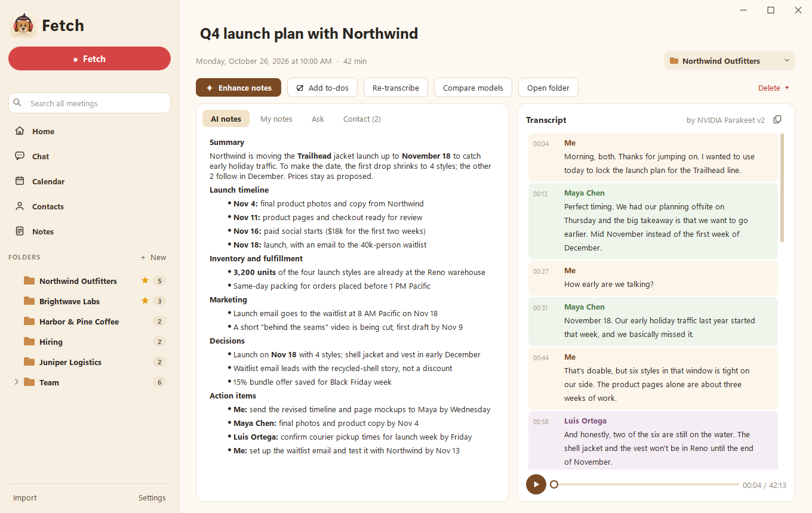
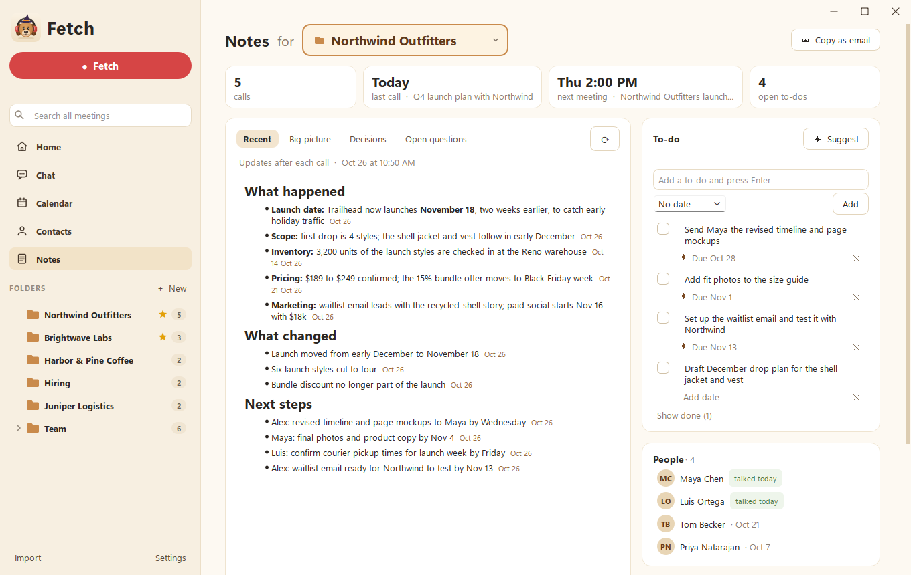

<h1 align="center">Fetch</h1>

<b>Your meetings, on your computer.</b> A meeting notetaker for Windows, made by Soggy Dog Studios

<a href="https://github.com/Soggy-Dog-Studios/fetch/releases/latest/download/FetchSetup.exe"><b>Download Fetch for Windows</b></a> · <a href="https://github.com/Soggy-Dog-Studios/fetch/releases">What's new</a>

## What it does

- **Records your calls:** Zoom, Google Meet, Microsoft Teams and Slack huddles, automatically or with one click. No bot joins the call.
- **Live transcript** while you talk, made on your own computer, with a careful clean-up pass after the call.
- **Knows who's talking:** Fetch learns your contacts' voices and labels the transcript with their names.
- **AI notes** with your Claude or ChatGPT plan: summary, decisions and action items, with your own notes worked in.
- **Folders** for clients or projects, filled automatically, each with notes that keep themselves up to date.
- **Ask anything** across all your calls, and see what's coming up on your calendar.

## Install

1. Download **FetchSetup.exe** from the link above and open it.
2. Fetch installs just for you (no administrator rights needed). The setup guide picks the right speech engine for
   your computer, with or without a graphics card.

Fetch updates itself: Settings > About checks for new versions. Every update is signed by Soggy Dog Studios, and
Fetch won't install one that isn't.

Needs Windows 10 or 11.

## Your data

Notes, transcripts and recordings stay on your computer, with optional Google Drive backup. Nothing is sent anywhere
unless you choose to.

## Questions

Visit [soggydogstudios.com](https://soggydogstudios.com).

---

Fetch is free to use under its license (shown in Settings > About). The source code isn't public.
